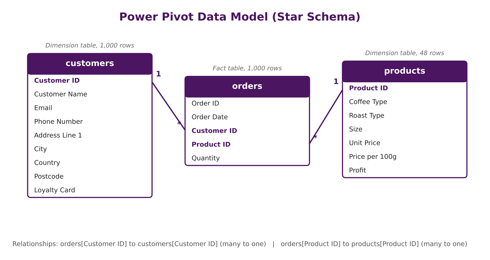
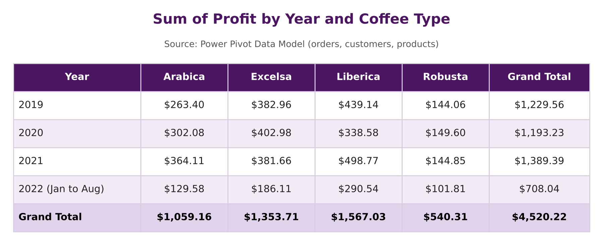
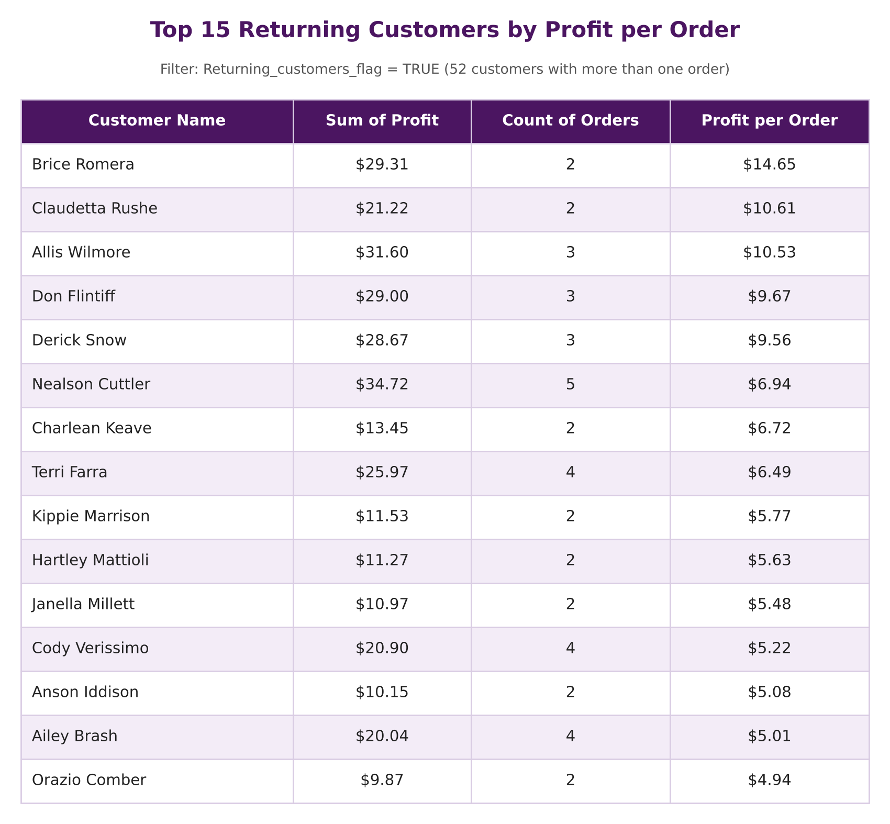

# ☕ Coffee Sales Power Pivot Model Analysis (Excel Project)

## 📌 Project Overview

This project uses Excel Power Pivot to analyze the profitability of an online coffee bean retailer. It loads three raw tables (orders, customers, and products) into a single Data Model, links them with relationships, and uses DAX and pivot tables to show where profit comes from.

The analysis covers 1,000 order lines from January 2019 to August 2022. It tracks profit by year, month, roast type, and coffee type, and it ranks returning customers by profit per order. Unlike my previous Coffee Sales Dashboard, this project replaces lookup formulas with a relational model, so the raw tables stay clean and every pivot table draws from one source.

## 🎯 Key Features

✅ Power Pivot Data Model: Orders, customers, and products load as separate tables in one model.  
✅ Star Schema Relationships: `orders` acts as the fact table, linked to `customers` and `products` by ID.  
✅ DAX Calculated Column: `Returning_customers_flag` marks customers who placed more than one order.  
✅ DAX Measure: `profit_per_order` divides total profit by the number of orders for each customer.  
✅ Monthly Profit Breakdown: Pivot table of profit by year, month, roast type, and coffee type.  
✅ Annual Profit Summary: Yearly profit compared across Arabica, Excelsa, Liberica, and Robusta.  
✅ Returning Customer Ranking: Repeat buyers ranked by profit per order, with total profit and order count.  

## 📷 Analysis Preview

<!-- Upload your screenshots to the repo and update the file names below. -->

**Data Model (Diagram View)**


**Profit by Coffee Type and Year**


**Returning Customer Ranking**


## 🗂️ Repository Files

| File | Description |
|------|-------------|
| `orders.csv` | Raw fact table: Order ID, Order Date, Customer ID, Product ID, and Quantity (1,000 rows) |
| `customers.csv` | Raw dimension table: customer name, contact details, country, and loyalty card status (1,000 rows) |
| `products.csv` | Raw dimension table: coffee type, roast type, size, unit price, price per 100g, and profit (48 rows) |
| `power_pivot_data_modeling_analysis.xlsx` | Finished workbook: Data Model, relationships, DAX, and pivot tables |

## 🧩 Data Modeling

- Imported `orders.csv`, `customers.csv`, and `products.csv` into the Power Pivot Data Model as separate tables.
- Built a **star schema** with `orders` as the fact table and `customers` and `products` as dimension tables.
- Created a many-to-one relationship from `orders[Customer ID]` to `customers[Customer ID]`.
- Created a many-to-one relationship from `orders[Product ID]` to `products[Product ID]`.
- Added the **`Returning_customers_flag`** calculated column to identify repeat buyers.
- Added the **`profit_per_order`** measure to compare how much profit each customer brings per order.
- Built every pivot table from the Data Model, so no lookup formulas or merged sheets were needed.

**Product ID format:** each code combines coffee type, roast, and size in kg. For example, `A-L-0.5` is Arabica, Light roast, 0.5 kg.

<!-- Optional: paste your exact DAX formulas here.
```dax
Returning_customers_flag = <your formula>
profit_per_order = <your formula>
```
-->

## 🛠️ Skills & Tools Applied

- Power Pivot: Data Model, Diagram View, table relationships
- Data Modeling: Star schema, fact and dimension tables, many-to-one relationships
- DAX: Calculated columns and measures
- Excel Features: Pivot tables with multi-level row and column grouping, report filters
- Customer Analytics: Segmenting returning customers and ranking them by profitability

## 📈 Business Questions Answered

This analysis provides insights into:

- Which coffee types and roast types bring in the most profit.
- How profit changes by year and by month.
- Which bag sizes drive the most profit.
- Which returning customers bring the most profit per order.

## 💡 Key Insights

- Total profit reached **$4,520** across 957 orders and 913 customers.
- **Liberica** was the most profitable coffee type at about 35% of profit ($1,567). **Robusta** trailed at about 12% ($540).
- Liberica led in 2019, 2021, and 2022. **Excelsa** led in 2020.
- **Light roast** was the top roast type at about 38% of profit.
- **2.5 kg bags** brought in over half of all profit (about 52%).
- **2021** was the most profitable full year at about $1,389. The 2022 total reflects a partial year, since the data ends in August.
- **52 customers** placed more than one order. **Brice Romera** led them at about $14.65 profit per order.

## 🚀 Learning Outcomes

Building this model strengthened my skills in:

📌 Designing a star schema with fact and dimension tables  
📌 Linking tables with relationships instead of lookup formulas  
📌 Writing DAX calculated columns and measures  
📌 Building pivot tables from a shared Data Model to answer profitability questions  

## 🙌 Acknowledgment

This project builds on my Coffee Sales Dashboard by moving from lookup formulas to a relational Data Model. It shows how Power Pivot can keep raw data clean while still answering detailed questions about products and customers.

## 🔗 Related Link

[LinkedIn Post](https://www.linkedin.com/feed/update/urn:li:share:7520824473374326784/)
<!-- Replace with your LinkedIn post URL. -->

## 👨‍💻 Author

**Omar Shazley**: Data Analyst | Excel, SQL, and healthcare data analytics

💼 [LinkedIn](https://www.linkedin.com/)  
📧 Email: [omarshazley@gmail.com](mailto:omarshazley@gmail.com)

✨ **If you like this project, don't forget to ⭐ star the repo!**
